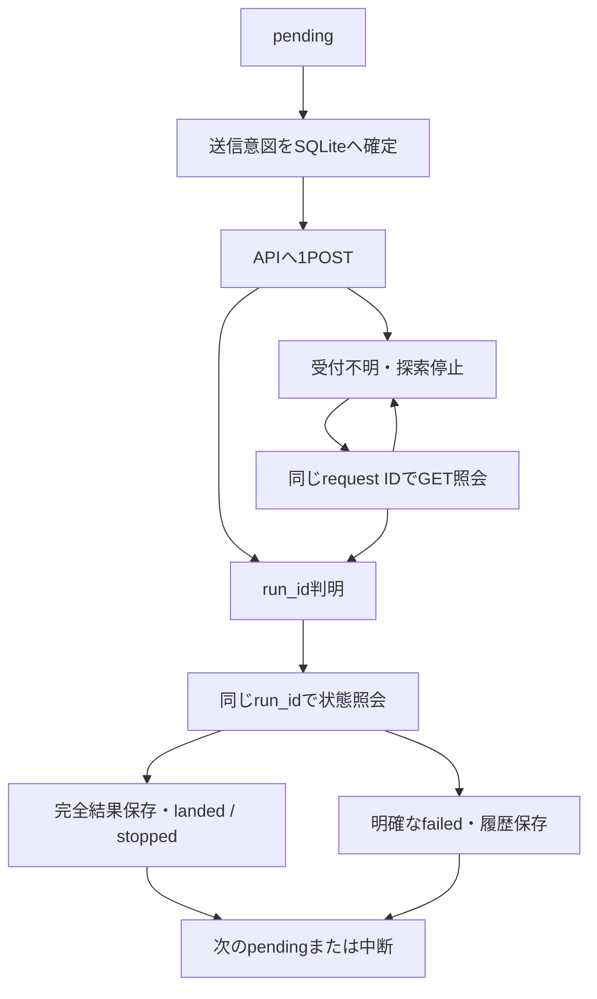

# 状態遷移・保存仕様

## 探索状態

| 状態 | 意味 | 次の操作 |
|---|---|---|
| created | 事前検査済み・まだ送信していない | run |
| running | 逐次実行または既存run照会中 | status、pause、Ctrl+C |
| paused | 利用者中断、通信/GFS/整合障害、受付不明など | 原因確認後resume。resumeが必ず進むわけではない |
| completed | 全候補がlanded/stopped/invalid_input/failedの終端 | status/detail/result/target/verify。failedのみ別操作retry可能 |

## 候補状態

| 状態 | 内容 | 通常再開での動作 |
|---|---|---|
| pending | まだ送信意図を保存していない | 実行順で1件だけ送る |
| sending | 送信前に要求全文/IDを確定保存した | 送信有無は断定せずGET照会のみ |
| submission_unknown | 応答不明または照会404 | GET照会のみ。自動再POSTしない |
| accepted | run_idが判明、queued等 | 同run_idをGET。次地点を送らない |
| running | 元APIで実計算中 | 同run_idをGET。次地点を送らない |
| landed | 完全結果が正常着地 | 再計算なし。距離順位対象 |
| stopped | 科学的途中停止 | 再計算なし。距離なし |
| invalid_input | 地点の座標/高度等が不備 | 再計算なし。修正は別探索 |
| failed | 明確な入力拒否/ジョブ失敗/再起動interrupted等 | 再計算なし。明示retryのみ |

sending/unknownは「送信していない」と同義ではない。POST前クラッシュとPOST後応答喪失を外部から判別できない場合がある。API照会404はその時点で未発見なので未知状態を維持する。

共通障害の場合はfailed保存後も探索をpausedにする。`EXECUTION_FAILED`は元APIが地点/共通原因を構造化して区別しないので、保守的に停止して確認を求める。科学stoppedは通常の地点終端として次へ進む。APIにない独自の地点エラーコードを、現行APIが必ず返すとは仮定しない。

## 永続保存

N07専用保存先：`n07.sqlite3`（SQLite application_id=2160707。所有識別のない既存DBは拒否）、SQLite WAL、synchronous=FULL。探索ドキュメントとSHA256を同じトランザクションで更新。固定条件・元候補・確定実行順のhashを別に保持し、ロードと更新で再検査。破損を無視して初期化しない。

- `search_id`、作成UTC、API URL、registry instance_id、API version。
- 正規化済み共通config、GFSの識別情報とスナップショット。
- 元候補、入力順、最遠点ペアからのWGS84実行順、地点別正規config。
- 各状態、attempt（要求ID/全文/hash/run_id/受付時刻/ジョブ時刻/成否）、エラー履歴。
- 中断/再開/完了/再試行/目標変更履歴。
- 目標、各評価時点の軽量順位、結果参照とhash、完全一致再利用元。

Store.connectはcontextmanager。内部のConnection contextでcommit/rollbackを終了し、外側finallyでcloseする。PRAGMA設定失敗・本文例外・commit/rollback例外でも解放する。BEGIN IMMEDIATE、WAL、synchronous=FULLは維持。生接続として返すAPIではなく、必ずwithで使う。

SQLiteの原子性は、対応するローカルファイルシステム上の通常のプロセスクラッシュについて使う。ネットワーク共有・同期フォルダー・ディスク故障・バックアップ欠如に対する保証ではない。N07保存先は既存APIのstate/registryとは分ける。

OSのrunner.lock（Linux flock / Windows msvcrt）により、同じN07保存先で計算を担当するプロセスを1つにする。status/target/pauseは別プロセスからSQLiteトランザクションで操作可能。未解決active要求が別探索に残る間、その保存先の別探索を走らせない。別々のN07保存先や外部APIクライアントの受付を全体管理する機能ではない。

## 完全結果と軽量結果

完全API結果を `results/<search_id>/<UUID>.json` に保存。partialへ書込み→flush/fsync→原子的rename→SQLite参照更新。参照は相対パス、内容SHA、byte数、run ID、API取得パスを含む。POSIXはディレクトリfsyncも実施。Windowsのrename・SQLite復旧は最終ユーザー試験が必要。

rename直後クラッシュの場合、未参照の完全blobが残る可能性がある。削除せず、同runを再GETして検証済みblobを新しく保存する。**再POSTはしない**。ローカルsnapshotがあるため、API結果が後から削除されても保存済みresult/target評価を利用できる。ディスク喪失は保証できないのでバックアップが必要。

本初版は入力データが最大50なので、APIの正式保存に加えて完全JSONをローカルに複写する方式を採用。重複地点は同じ保存blobを参照し、再利用元を明示。科学結果自体の物理値を修正しない。元APIのresultsファイルとN07保存JSONは包装/書式が異なり、SHAが同じだとは主張しない。

最大API応答64MiB。超過時は停止し、巨大resultを黙って切り捨てない。軽量状態は緯度経度・status・距離・rank・error・参照だけで、全軌道をSQLiteドキュメントへ重複展開しない。`result`コマンドで選択候補の全軌道を読む。`verify`でローカル完全blobのhashを検査する。

## GFSとソース同一性

GET weather-sourcesの登録情報から、label/default_config以外を固定する。idだけでなくSHA/bytes/日時/領域/metadata等を比較。新run・新ファイル・利用不能・instance変更は自動置換しない。

ただし同エンドポイントの登録情報はサービス起動時等のsnapshot。毎GETで現在のファイルhashを計算するAPIではない。元submit/workerの検査、受領run.specとresultのweather_snapshotも照合する。N07単独で実ファイルの現在同一性を直接証明していない。

現在のソース/数値環境fingerprintを実行前に取得するAPIがない。最初に受領したrun specのsource_snapshotを固定し、後続run/resultで同じsnapshotを要求する。違うソースで元APIが実行を開始してしまうことを事前完全防止する機能はない。発見後はpausedにし、その結果を順位/再利用へ取り込まない。

## 同一計算再利用

初版は**同じ探索内だけ**。キーは正規化済み完全config（位置・ASL高度・日時・機体・数値制御すべて）＋固定GFS情報＋固定source_snapshot。未確定/failed/invalid結果は再利用しない。donorの完全JSON/hashを検査。近接点・同じGFS格子は統合しない。landedとstoppedを再利用可能だが、stoppedに距離を付けない。

異なる探索の結果を検索して自動再利用する機能は未実装。別条件探索は別ID・別履歴。条件修正で旧探索を更新しない。

## 目標変更

targetは固定計算条件hashから除外。`target`操作で履歴/評価UTC/座標を保存し、既存正常着地点へN06 WGS84距離を再適用。飛行/API通信ゼロ。計算途中の順位は完了着地点の範囲だけで、最適解・安全な候補と呼ばない。
